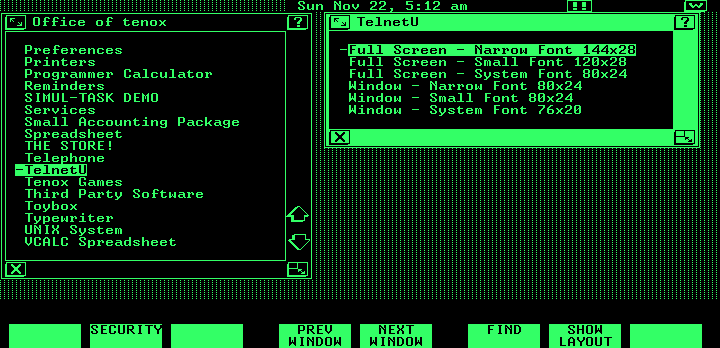
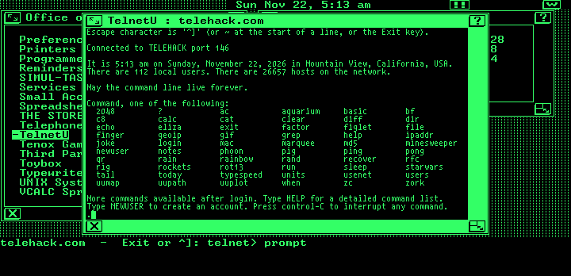
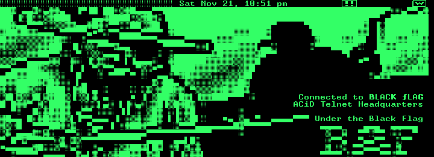
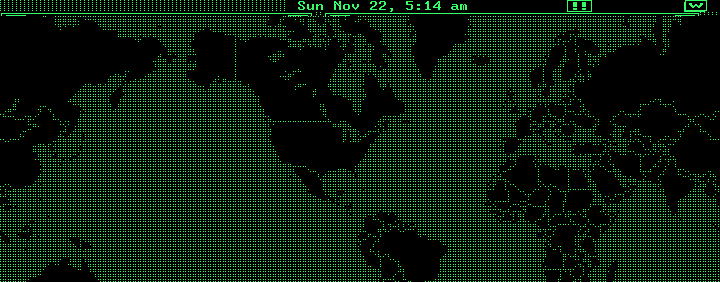

# telnetu

A telnet client for the AT&T UNIX PC (3B1, PC 7300), with UNIX 3.51 and
the TWG WIN/TCP Ethernet software. It has its own terminal: a VT100 and
xterm, with UTF-8. So the telnet hosts of today look right on the 3B1:
BBSes with CP437 art, MUDs, nethack.alt.org, telehack.com, the
mapscii.me world map, sdf.org.

It runs on a real 3B1 and in [FreeBee](https://github.com/tenox7/freebee),
the 3B1 emulator. The AT&T UNIX PC kit for FreeBee has it installed (see
Download).









More pictures: [screenshots](screenshots).

The old TWG telnet (1986) gives the host's output to the 3B1 window as it
comes. That window is not a VT100 and knows no UTF-8, so on today's hosts
the screen goes wrong. The old client also loops on hosts that offer the
STATUS option, and it hangs on the serial port. telnetu goes next to it:
the old telnet stays /usr/bin/telnet.


## Use

In the Office, open TelnetU. Its menu has 6 ways to run it:

- Full Screen: all of the screen, in the system font (80 x 24), the
  small font (120 x 28) or the narrow font (144 x 28).
- Window: a window with a border, in the small font (80 x 24), the
  system font (76 x 20) or the narrow font (80 x 24). Move it with the
  box at its top left, resize it with the box at its bottom right: the
  host gets the new size. The X box at its bottom left closes it.

A box asks for the host. Type its name or its address, then press Return
or Enter. A port may follow the host: 10.0.2.2 2323. Cmd shows the known
hosts (/usr/ethernet/ua/HostTable, else /etc/hosts): choose one with the
arrows and Return, or click it. With no host, you get the telnet> prompt.
Exit closes the box. The window's title is "TelnetU : " and the host's
name.

In a UNIX System window, or on a terminal: telnetu host [port].

Keys in the window:

- Exit gives the telnet> prompt. There, Return goes back to the host,
  and Exit again closes the connection and the window. ^] does the same
  as Exit. So does ~ at the start of a line, as in the old telnet: ~quit
  closes the connection, and ~~ sends one ~.
- Cancl, or the X box, closes the connection and the window at once.
- Help lists the telnet> commands. Rfrsh draws the screen again. Break
  sends a telnet BREAK.
- The arrows, Page, Shift-Page, Home, End and F1 to F8 (Shift: F9 to
  F16) go to the host. Mouse clicks go to hosts that ask for them
  (xterm, SGR).
- In FreeBee: Alt+Esc is Exit, Alt+Backspace is Cancl, PageUp is Help
  and Insert is Cmd.


## What it does

- VT100, VT220 and xterm: scroll regions, insert and delete, the
  alternate screen, DEC line drawing, bold, underline, reverse, italic.
  Colours become reverse (light background) or normal.
- UTF-8: box lines, blocks, shades, braille, accents (on capitals too),
  combining marks, Greek and Cyrillic as Latin letters, many symbols.
  Wide letters take 2 cells. It finds by itself a host that sends CP437
  (BBS art).
- Fonts: system (9 x 12 pixels, the default), small (6 x 10, from
  PLAIN.R.E.11.A) and narrow (5 x 10, from system.144.ft), or a 3B1 font
  file. Lines, blocks, braille, accents and symbols are drawn for every
  size of cell.
- The most cells: without a border, system 80 x 24, small 120 x 28,
  narrow 144 x 28; with a border, system 76 x 20, small 114 x 24, narrow
  137 x 24. A new size of the window goes to the host (NAWS).
- Names that are not in /etc/hosts are looked up with DNS: the
  nameserver line of /etc/resolv.conf, else 10.0.2.3 (the DNS server of
  FreeBee's user networking).
- Telnet options: BINARY, ECHO, SGA, TTYPE (XTERM, then VT100), NAWS,
  CHARSET (UTF-8) and TM. It refuses the others, with no loops
  (RFC 1143). A port number (telnetu host 2323) still negotiates.
- On a terminal (the serial port, rlogin or telnet into the 3B1, or -t),
  the host's output goes to your terminal as it comes, as with the old
  telnet. The terminal type is your $TERM. With -a, UTF-8 and CP437
  become plain ASCII: lines become + - |, letters lose their accents.
- The telnet> commands, as in BSD telnet: open, close, quit, status,
  send (ayt brk ip ao ec el eof nop escape), z (a local shell), escape,
  term, charset, crlf, bs, mode line|char, options. In a window also:
  window [CxL] (a border), full [CxL] (no border), font [name] (no name:
  the list), size CxL. ? lists them.

```
Usage: telnetu [-w] [-f font] [-g colsxlines] [-t] [-a] [-e c]
               [-T type,...] [-C charset] [host [port]]
  -w          a window with a border, which the user can move and resize
  -f font     system (the default), small, narrow, or a 3B1 font file
  -g CxL      the size in cells, such as -g 100x30. The default: 80x24
              with -w (or as much as fits), else all of the screen
  -t          plain terminal mode, also in a window
  -a          plain terminal mode (as -t): UTF-8 and CP437 to ASCII
  -e c        escape character (^] if not given)
  -T types    terminal types to give the host, e.g. -T vt100
  -C charset  auto (default), utf8, latin1 or cp437
  -V          the version
```


## Download

- The 3B1 program with its Office files and this source, as
  tenox_3b1_telnetu.tar.lz: on the
  [Releases](https://github.com/tenox7/telnetu/releases) page, or
  [here](https://files.42718.net/mirror/tenox/os/att/3b1/software/tenox_3b1_telnetu.tar.lz).
- A whole 3B1 for macOS, Linux and Windows, with telnetu installed:
  [att3b1-unix351-freebee.tar.lz](https://files.42718.net/mirror/tenox/os/att/3b1/virt/att3b1-unix351-freebee.tar.lz),
  FreeBee with UNIX 3.51 and a disk full of software.


## Install

On your computer, unpack tenox_3b1_telnetu.tar.lz:

    lzip -dc tenox_3b1_telnetu.tar.lz | tar xf -

Copy its bin and ua folders to the 3B1, for example with ftp in binary
mode. Close all TelnetU windows. Then, as root, in the folder that holds
bin and ua:

    rm -f /usr/bin/telnetu
    cp bin/telnetu /usr/bin/telnetu
    chmod 755 /usr/bin/telnetu
    chown bin /usr/bin/telnetu; chgrp bin /usr/bin/telnetu
    cp ua/telnetu.hlp /usr/lib/ua/telnetu.hlp
    cp ua/TelnetU /usr/lib/ua/TelnetU
    chmod 644 /usr/lib/ua/telnetu.hlp /usr/lib/ua/TelnetU
    cp /usr/lib/ua/Office /usr/lib/ua/Office.tnu
    sh ua/office-fix.sh ua/Office.add

Log out of the Office and log in again: the Office then has TelnetU.
office-fix.sh puts the 4 lines of ua/Office.add at the end of
/usr/lib/ua/Office, and takes out the TelnetU items of an older telnetu.
If other items come after those, it changes nothing.

Do not copy a new telnetu over one that ran before: remove the old file
first (rm, then cp). Else the 3B1 can run stale pages of the old program,
and the new one stops with "Memory fault".

To remove it: delete /usr/bin/telnetu, /usr/lib/ua/telnetu.hlp and
/usr/lib/ua/TelnetU, and the 4 TelnetU lines at the end of
/usr/lib/ua/Office (or copy Office.tnu back, if you added nothing to the
Office after telnetu).


## Build

On the 3B1, with gcc 2.5.8 in /usr/local/bin (the FreeBee kit has it)
and the TWG headers in /usr/ethernet/include:

    PATH=/usr/local/bin:$PATH; export PATH
    sh mk3b1

It makes telnetu. mk3b1 removes the old telnetu first.

    telnet.c       the telnet protocol, the commands, main
    vt.c           the terminal: VT100/xterm control codes, UTF-8
    glyph.c        letters and symbols, drawn into the bitmap
    syms.txt       the symbol pictures, 12 rows of 9 pixels each
    syms.h         made from syms.txt by tools/mksyms.py
    w3b1.c         the 3B1 window (tam, wrastop, its border and size),
                   the host box
    ttyb.c         plain terminal mode
    net.c          sockets, DNS
    tn.h           what they share
    mk3b1          the build for the 3B1
    ua/Office.add  the Office item: 4 lines for the end of /usr/lib/ua/Office
    ua/TelnetU     its menu, in /usr/lib/ua
    ua/telnetu.hlp its Help pages, in /usr/lib/ua
    ua/office-fix.sh  puts Office.add at the end of /usr/lib/ua/Office
    Makefile, wsim.c  a stand-in for a Mac or another Unix (make tnsim):
                   keys come from a script, the screen goes to PNG and
                   text files. The top of wsim.c tells how. make
                   FONTDIR=dir/ takes the 3B1 font files from dir.
    tools/mksyms.py    makes syms.h
    tools/tortured.py  a telnet server that tortures clients

Tests: tools/tortured.py tries option loops, UTF-8, CP437, colours,
scroll regions, the alternate screen, a 100 KB burst and mouse reports.
Run it on the computer that runs FreeBee (python3 tortured.py -p 2323),
then on the 3B1: telnetu 10.0.2.2 2323. For a 3B1 on a LAN, add
-b 0.0.0.0.


## License

Apache License 2.0. See LICENSE.
