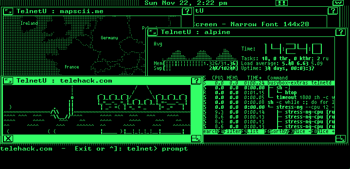

# telnetu

A telnet client for the AT&T UNIX PC (3B1, PC 7300) with its own VT100/xterm
terminal, UTF-8 and DNS. Today's telnet hosts look right on the 3B1: BBSes
with CP437 art, MUDs, nethack.alt.org, telehack.com, mapscii.me, sdf.org.
Full screen, or in windows that you move and resize.

It runs on a real 3B1 and in [FreeBee](https://github.com/tenox7/freebee).
The old TWG telnet (1986) stays /usr/bin/telnet.
More pictures: [screenshots](screenshots).

## Use

In the Office, open TelnetU and pick full screen or a window, in the
system, small or narrow font. Type the host (a port may follow), then
Return. Cmd lists the known hosts. Or in a shell:

    telnetu [-w] [-f system|small|narrow] [-g colsxlines] host [port]

Exit gives the telnet> prompt: Return goes back to the host, Exit again
quits. Cancl or the X box closes the window. In FreeBee, Alt+Esc is Exit
and Alt+Backspace is Cancl.

## Download

- [Releases](https://github.com/tenox7/telnetu/releases):
  tenox_3b1_telnetu.tar.lz, the 3B1 program with its Office files and
  this source.
- A whole 3B1 for macOS, Linux and Windows with telnetu installed:
  [att3b1-unix351-freebee.tar.lz](https://files.42718.net/mirror/tenox/os/att/3b1/virt/att3b1-unix351-freebee.tar.lz)

## Install

Copy bin and ua from the tarball to the 3B1 (ftp in binary mode). Close
all TelnetU windows, then as root:

    rm -f /usr/bin/telnetu
    cp bin/telnetu /usr/bin/telnetu; chmod 755 /usr/bin/telnetu
    cp ua/telnetu.hlp ua/TelnetU /usr/lib/ua
    chmod 644 /usr/lib/ua/telnetu.hlp /usr/lib/ua/TelnetU
    cp /usr/lib/ua/Office /usr/lib/ua/Office.tnu
    sh ua/office-fix.sh ua/Office.add

Log in to the Office again. Always rm the old telnetu before cp, else the
new one can stop with "Memory fault".

## Build

On the 3B1, with gcc 2.5.8 (the FreeBee kit has it):

    PATH=/usr/local/bin:$PATH; export PATH
    sh mk3b1

## License

Apache License 2.0
